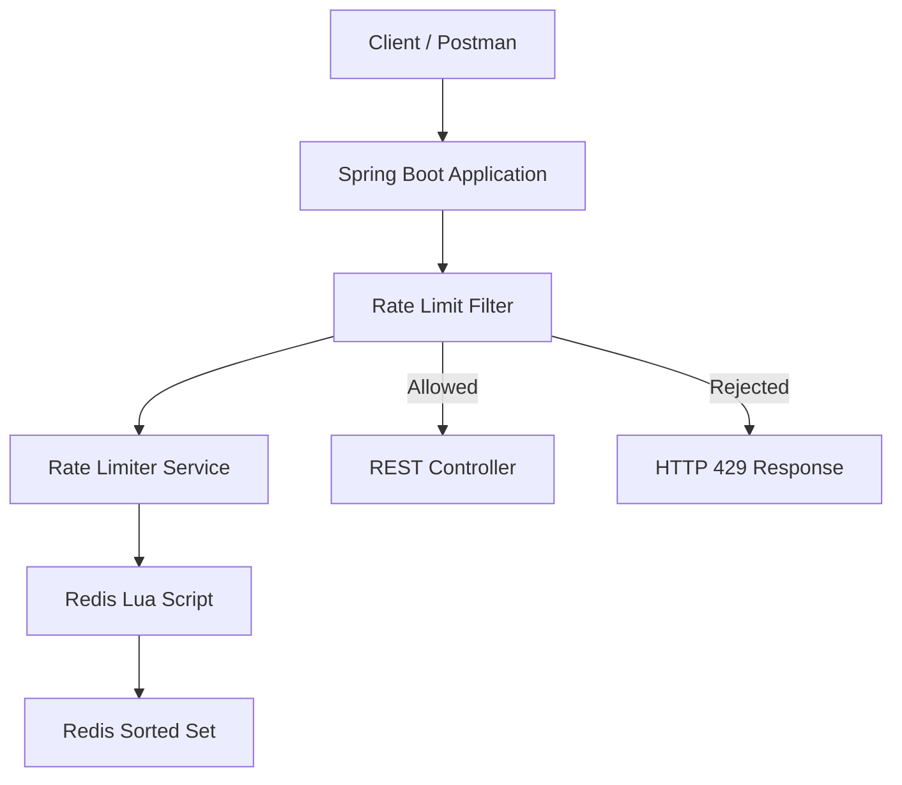

# Redis Rate Limiter

A Redis-powered rate limiting system built with Spring Boot and Java 25, exploring how distributed applications control incoming API traffic using the **Sliding Window Log** algorithm.

## Overview

Rate limiting is a technique used to restrict how many requests a client can make within a specific time period.

This project explores how Redis can be used to implement an efficient and centralized rate limiter, helping prevent excessive API requests while maintaining consistent limits across application instances.

The primary goal is to understand Redis data structures, atomic operations, and Lua scripting through a practical backend project.

## Tech Stack

- **Language:** Java 25
- **Framework:** Spring Boot 4.1.2
- **Database / In-memory Store:** Redis
- **Redis Data Structure:** Sorted Sets (ZSET)
- **Scripting:** Redis Lua Scripts
- **Build Tool:** Maven
- **API Testing:** Postman

## Rate Limiting Algorithm

The project focuses on the **Sliding Window Log** algorithm.

Unlike a fixed window counter, which resets at fixed time boundaries, the sliding window log considers requests within a continuously moving time window.

For example, with a limit of 5 requests per 60 seconds:

- Each incoming request is recorded with its timestamp.
- Requests older than the current 60-second window are removed.
- The remaining requests are counted.
- If the count is below the limit, the request is allowed.
- Otherwise, the request is rejected with HTTP `429 Too Many Requests`.

## Why Redis Sorted Sets?

Redis Sorted Sets (ZSET) are used to maintain request timestamps efficiently.

- **Score:** Request timestamp.
- **Member:** Unique request identifier.
- **ZREMRANGEBYSCORE:** Removes expired requests.
- **ZCARD:** Counts requests in the active window.
- **ZADD:** Records a new request.

## Atomic Execution with Lua

A rate limiter must handle concurrent requests correctly.

If multiple requests check the request count simultaneously, they could all pass the check and exceed the configured limit.

To prevent this, Redis Lua scripting will execute the rate-limiting operations atomically:

1. Remove expired requests.
2. Count active requests.
3. Check the configured limit.
4. Record the request if allowed.
5. Set key expiration.

This keeps the complete decision process atomic within Redis.

## Architecture

## Planned Features

- [ ] Configure Spring Boot and Redis connection.
- [ ] Implement a basic fixed-window rate limiter for comparison.
- [ ] Implement Sliding Window Log using Redis Sorted Sets.
- [ ] Execute rate-limiting operations through Lua scripts.
- [ ] Create a reusable rate-limiting service.
- [ ] Integrate rate limiting using a Spring Boot filter.
- [ ] Return HTTP 429 when the request limit is exceeded.
- [ ] Test concurrent requests and edge cases.
- [ ] Document API endpoints and implementation decisions.

## Initial Configuration

The initial rate limit will be:

| Setting | Value |
|---|---|
| Maximum requests | 5 |
| Time window | 60 seconds |
| Algorithm | Sliding Window Log |
| Redis data structure | Sorted Set |
| Client identification | Request header |

These values may become configurable as the project evolves.

## Learning Objectives

Through this project, I aim to gain practical experience with:

- Redis data structures and commands.
- Rate-limiting algorithms.
- Atomic execution and concurrency.
- Redis Lua scripting.
- Spring Boot filters and interceptors.
- Distributed application design.

## Project Status

🚧 **Under Development**

This is a hands-on learning project focused on understanding Redis and implementing rate limiting in a Spring Boot application.

More implementation details, API examples, and testing documentation will be added as development progresses.
